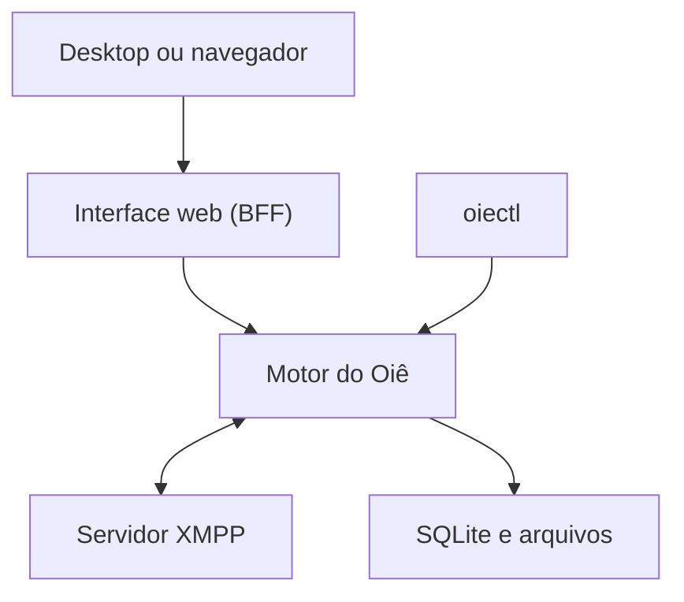

# Arquitetura e deploy do Oiê

Você pode executar o Oiê no próprio computador ou manter um motor em um servidor privado e acessá-lo de vários dispositivos.

## Componentes do Oiê

O motor do Oiê mantém as conexões com os servidores XMPP e guarda o histórico e os envios pendentes em SQLite. O diretório de dados também guarda os arquivos de mídia retidos e as credenciais XMPP. A interface web usa uma camada de apresentação (BFF) que chama a API HTTP do motor. O aplicativo de desktop exibe essa mesma interface em uma janela nativa, e o [`oiectl`](../cli/index.md) acessa diretamente a API de um motor independente.



Cada instância atende a um único dono, que pode conectar várias contas XMPP. Vários dispositivos podem usar o mesmo motor hospedado e consultar o histórico que ele guarda. Rascunhos e preferências de exibição continuam no dispositivo, e motores independentes mantêm bases separadas. A sincronização entre motores ainda está planejada.

## Uso local

**Desktop.** [Instale o aplicativo](../../baixar/index.md) no macOS ou Linux. O motor e a interface rodam juntos no computador, e o aplicativo usa o diretório de dados do seu usuário. Fechar a janela mantém o motor ativo. Sair do aplicativo encerra o motor.

**Navegador ou CLI.** Com Go 1.27.4 ou mais recente e Make, compile a partir do [repositório do Oiê](https://github.com/araihu/oie/tree/883551afe9f4f9a4ef2c27b1fc34c87fd4fd1a2f) e inicie a interface e a API na mesma porta.

```sh
make build
bin/oie --role local --listen 127.0.0.1:8080 --data-dir ./data
```

Abra [127.0.0.1:8080](http://127.0.0.1:8080) e [conecte sua conta XMPP](../manual/index.md#contas-xmpp). O processo continua ativo quando você fecha a aba. Para automação, use o [guia do CLI](../cli/index.md#compilar-e-conectar).

## Motor hospedado

Use o modo `hosted` para manter as conexões XMPP, o histórico e os envios pendentes no servidor. As abas do navegador podem fechar enquanto o motor continua em execução. Escolha um diretório persistente e privado para `--data-dir`, mantenha um único processo por diretório e preserve o diretório completo ao fazer uma cópia de segurança com o motor parado. Ele contém as credenciais XMPP da instância.

Com o binário compilado no passo anterior, rode no servidor. A interface web acompanha o motor por padrão.

```sh
bin/oie --role hosted --listen 127.0.0.1:8080 \
  --data-dir /caminho/persistente/oie
```

O Oiê ainda não tem autenticação própria para o acesso ao servidor. Mantenha a interface e a API acessíveis apenas por um meio privado com controle de acesso. Por exemplo, com acesso SSH ao servidor, abra um túnel a partir do computador cliente.

```sh
ssh -N -L 127.0.0.1:8080:127.0.0.1:8080 usuario@servidor
```

Com o túnel aberto, acesse [127.0.0.1:8080](http://127.0.0.1:8080) no computador cliente. Para manter o motor ativo após desconectar do servidor, execute-o como um serviço supervisionado pelo sistema. Confira se o motor está pronto pela rota de saúde.

```sh
curl --fail http://127.0.0.1:8080/api/v1/health
```

## Interface e motor em processos separados

Para separar a interface do motor, inicie o motor hospedado com `--data-only` e rode o BFF apontando para ele. Os comandos abaixo usam duas portas privadas no mesmo servidor e rodam em terminais separados.

```sh
bin/oie --role hosted --data-only --listen 127.0.0.1:8080 \
  --data-dir /caminho/persistente/oie
```

```sh
bin/oie --role bff --listen 127.0.0.1:8081 \
  --engine-url http://127.0.0.1:8080
```

Nesse arranjo, a interface está na porta `8081` e o `oiectl` usa a porta `8080`. Só o motor abre o banco e se conecta ao XMPP. O desktop também pode usar um motor existente por meio de [`--engine-url`](https://github.com/araihu/oie/blob/883551afe9f4f9a4ef2c27b1fc34c87fd4fd1a2f/docs/desktop.md#runtime-options).

O motor serve seu próprio contrato em `/api/openapi.yaml`. A referência da versão de desenvolvimento está no [catálogo OpenAPI da Arai Hû](https://oapi.araihu.com/catalogs/oie/documents/engine-next/).
