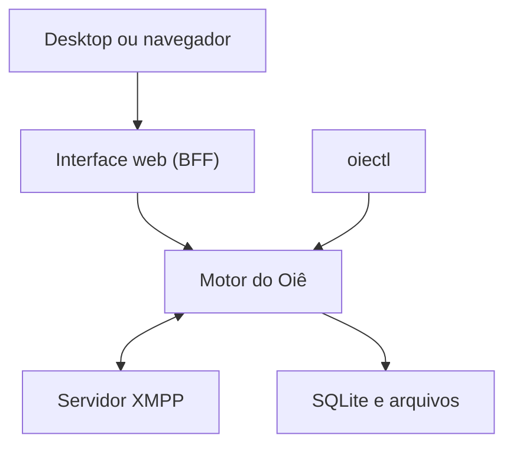

# Arquitetura e deploy do Oiê

Você pode executar o Oiê no próprio computador ou manter um motor em um servidor privado e acessá-lo de vários dispositivos.

## Componentes do Oiê

O motor do Oiê mantém as conexões com os servidores XMPP e guarda o histórico e os envios pendentes em SQLite. O diretório de dados também guarda os arquivos de mídia retidos e as credenciais XMPP. A interface web usa uma camada de apresentação (BFF) que chama a API HTTP do motor. O aplicativo de desktop exibe essa mesma interface em uma janela nativa, e o [`oiectl`](../cli/index.md) acessa diretamente a API de um motor independente.



Cada instância atende a um único dono, que pode conectar várias contas XMPP. Vários dispositivos podem usar o mesmo motor hospedado e consultar o histórico que ele guarda. Rascunhos e preferências de exibição continuam no dispositivo, e motores independentes mantêm bases separadas. A sincronização entre motores ainda está planejada.

Desde a rc.14, os motores local e hospedado preparam o índice de busca Bleve em segundo plano, no diretório de dados. A busca geral e a busca na conversa continuam disponíveis via SQLite durante a preparação do índice ou quando ele não puder atender à consulta. A variável `OIE_EXPERIMENTAL_BLEVE_SEARCH`, usada na rc.13, foi removida.

Veja os diagramas e o catálogo de tabelas e views em [Banco de dados](../banco-de-dados/index.md).

## Uso local

**Desktop.** [Instale o aplicativo](../../baixar/index.md) no macOS ou Linux. O motor e a interface rodam juntos no computador, e o aplicativo usa o diretório de dados do seu usuário. Fechar a janela mantém o motor ativo. Sair do aplicativo encerra o motor.

**Navegador ou CLI.** Com Go 1.27.4 ou mais recente e Make, compile a partir do [código-fonte da v0.0.1-rc.23](https://github.com/araihu/oie/tree/c5c3f37aeb815dd9ee4a1e94512ebf7fd2467071) e inicie a interface e a API na mesma porta.

```sh
make build
bin/oie --role local --listen 127.0.0.1:8080 --data-dir ./data
```

Abra [127.0.0.1:8080](http://127.0.0.1:8080) e [conecte sua conta XMPP](../manual/index.md#contas-xmpp). O processo continua ativo quando você fecha a aba. Para automação, use o [guia do CLI](../cli/index.md#compilar-e-conectar).

## Docker

A [imagem do Oiê](https://github.com/araihu/oie/pkgs/container/oie) roda o motor e a interface web em Linux amd64 e arm64. O [guia de instalação](../instalacao/index.md#rodar-com-docker) mostra como iniciar o contêiner.

- `:latest` acompanha a versão mais recente marcada com uma tag, incluindo pré-lançamentos.
- `:main` acompanha a versão de desenvolvimento.
- Uma tag como `:v0.0.1-rc.23` seleciona uma versão específica.

O volume `oie-data` guarda as contas, o histórico e os arquivos de mídia. Para atualizar com `:latest`, baixe a imagem com `docker pull ghcr.io/araihu/oie:latest`, pare e remova o contêiner antigo e execute novamente o comando do guia com o mesmo volume.

Mantenha a porta em localhost. Para acessar o Oiê de outro computador, use o túnel SSH descrito em [Motor hospedado](#motor-hospedado). A imagem vem sem FFmpeg, por isso a geração de miniaturas de vídeo está indisponível no contêiner.

## Motor hospedado

Use o modo `hosted` para manter as conexões XMPP, o histórico e os envios pendentes no servidor. As abas do navegador podem fechar enquanto o motor continua em execução. Escolha um diretório persistente e privado para `--data-dir`, mantenha um único processo por diretório e preserve o diretório completo ao fazer uma cópia de segurança com o motor parado. Ele contém as credenciais XMPP da instância.

Com o binário compilado no passo anterior, rode no servidor. A interface web acompanha o motor por padrão.

```sh
bin/oie --role hosted --listen 127.0.0.1:8080 \
  --data-dir /caminho/persistente/oie
```

O Oiê ainda não tem autenticação própria para o acesso ao servidor. Mantenha a interface e a API acessíveis apenas por um meio privado com controle de acesso. Por exemplo, com acesso SSH ao servidor, abra um túnel a partir do computador cliente.

```sh
ssh -N -L 127.0.0.1:8080:127.0.0.1:8080 usuario@servidor
```

Com o túnel aberto, acesse [127.0.0.1:8080](http://127.0.0.1:8080) no computador cliente. No desktop, você também pode informar o endereço do túnel em [Configurações → Geral → Motor](../manual/index.md#motor-local-ou-remoto). Para manter o motor ativo após desconectar do servidor, execute-o como um serviço supervisionado pelo sistema. Confira se o motor está pronto pela rota de saúde.

```sh
curl --fail http://127.0.0.1:8080/api/v1/health
```

### Acesso público com OIDC

A autenticação nativa está no código de desenvolvimento do Oiê. Use uma
compilação que inclua esse recurso. As instruções da rc.23 acima continuam
adequadas para acesso privado por túnel.

1. No provedor OIDC, registre um cliente web confidencial com o retorno
   `https://oie.exemplo.com/auth/callback`. Anote o emissor, o ID do cliente
   e o `sub` da conta que será dona da instância. Guarde o segredo do cliente
   em um arquivo privado.
2. No servidor, configure a conta dona com `oie auth init`. Use o mesmo
   diretório de dados do motor e informe `--issuer` e `--subject`.
3. Inicie com `--role hosted`, `--public-url https://oie.exemplo.com`,
   `--oidc-client-id` e `--oidc-client-secret-file`. Configure o certificado
   HTTPS no Oiê ou um proxy TLS confiável. Abra o endereço público e selecione
   **Entrar**.

Ao abrir um link de conversa, de notificação ou de busca sem uma sessão,
entre para voltar ao destino solicitado. Ao clicar em uma notificação da
instância hospedada, o navegador abre o link da mensagem em uma janela.
O botão **Sair**, em **Configurações**, encerra a sessão nas abas. Se a sessão
expirar antes de um novo envio chegar ao motor, entre novamente para
continuar com o rascunho salvo.

A conta dona tem acesso completo à instância. O comando `oie auth recover`
troca a identidade vinculada e revoga as sessões e chaves existentes. O
histórico e as contas XMPP ficam no diretório de dados. Para automação, veja
[acesso ao motor hospedado pelo CLI](../cli/index.md#autenticar-no-motor-hospedado).

Para checagens de um balanceador de carga, configure `--probe-listen` com
um endereço HTTP restrito à rede privada. Consulte `/readyz` para saber se
o motor pode receber tráfego e `/livez` para verificar se o processo
responde. Essas rotas ficam em uma porta própria e dispensam credenciais.
No chart Helm com autenticação habilitada, o Kubernetes consulta diretamente
a porta 8081 do pod.

## Interface e motor em processos separados

Para separar a interface do motor, inicie o motor hospedado com `--data-only` e rode o BFF apontando para ele. Os comandos abaixo usam duas portas privadas no mesmo servidor e rodam em terminais separados.

```sh
bin/oie --role hosted --data-only --listen 127.0.0.1:8080 \
  --data-dir /caminho/persistente/oie
```

```sh
bin/oie --role bff --listen 127.0.0.1:8081 \
  --engine-url http://127.0.0.1:8080
```

Nesse arranjo, a interface está na porta `8081` e o `oiectl` usa a porta `8080`. Só o motor abre o banco e se conecta ao XMPP. O desktop também pode usar um motor existente por meio de [`--engine-url`](https://github.com/araihu/oie/blob/c5c3f37aeb815dd9ee4a1e94512ebf7fd2467071/docs/desktop.md#runtime-options).

O motor serve seu próprio contrato em `/api/openapi.yaml`. A referência da versão de desenvolvimento está no [catálogo OpenAPI da Arai Hû](https://oapi.araihu.com/catalogs/oie/documents/engine-next/).
