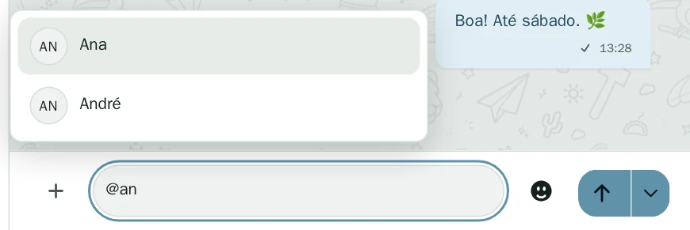

# Atalhos do Oiê

## Campo de mensagem

| Tecla ou texto | Ação |
| --- | --- |
| **Enter** | Em telas com mais de 720 px de largura e ponteiro preciso, envia a mensagem. Em tela estreita ou dispositivo com toque como ponteiro principal, insere uma quebra de linha. |
| **Shift + Enter** | Insere uma quebra de linha. |
| **↑** com o campo vazio | Abre a edição da última mensagem de texto simples que você enviou nesta conversa e que ainda pode ser editada. O envio precisa ter sido feito pelo mesmo Oiê na conexão atual. |
| **Esc** durante a edição | Sai da edição e volta ao campo de mensagem. |
| `@` no início de uma palavra em uma sala | Abre sugestões de participantes. Use **↑** e **↓** e confirme com **Enter**. **Tab** também confirma se você digitou parte do apelido e há uma sugestão selecionada. |
| `:joinha` ou `:thumbs-up` no início de uma palavra | Abre sugestões de emoji. Use **↑** ou **↓** e confirme com **Enter** para inserir o emoji. |
| **Esc** com sugestões abertas | Fecha as sugestões. |

Os idiomas dos atalhos de emoji podem ser escolhidos nas configurações de composição. Por padrão, o Oiê aceita nomes em português e inglês.

## Busca na conversa

Com o foco no campo de busca da conversa, **Enter** vai para o resultado mais antigo seguinte, **Shift + Enter** volta para um resultado mais recente e **Esc** fecha a busca.

## Barra lateral

Com o foco no separador da barra lateral, **←** e **→** ajustam a largura, **Home** e **End** escolhem a largura mínima ou máxima e **Enter** recolhe ou expande a barra.

## Aplicativo de desktop

Use **⌘ + Q** no macOS ou **Ctrl + Q** no Linux para encerrar o Oiê. Fechar apenas a janela mantém a conexão e o processamento de envios.
