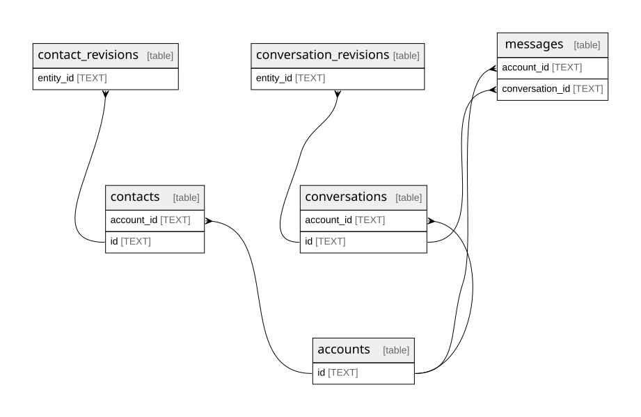
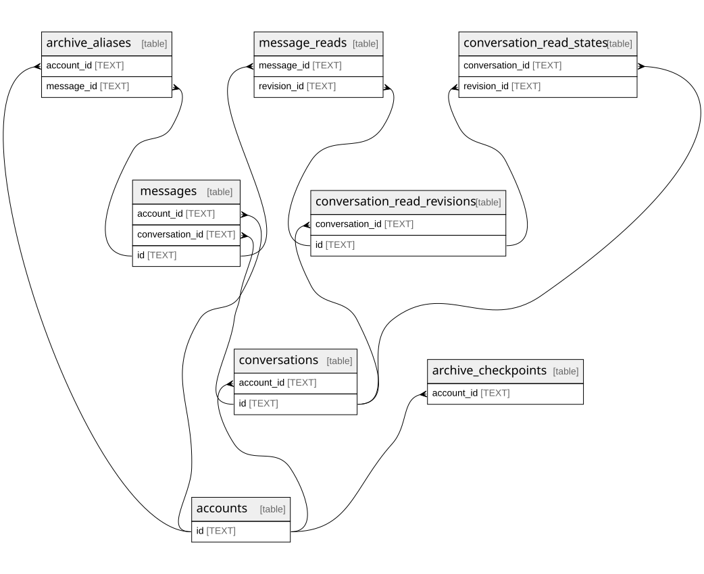
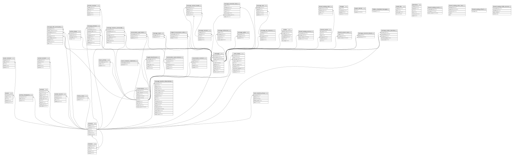

# Banco de dados

O motor do Oiê usa SQLite para guardar contas, conversas, mensagens e envios pendentes. No desktop com motor local, o banco `oie.sqlite` fica no [diretório do perfil](../instalacao/index.md#atualizar-remover-e-guardar-seus-dados). Para o motor em servidor ou Docker, consulte [Arquitetura e deploy](../arquitetura/index.md).

Esta referência descreve o esquema da versão de desenvolvimento. As abas de mídia, links e documentos já existiam na `v0.0.1-rc.9`. A migração `000027`, posterior à rc.9, acrescenta tabelas e views para indexar e ordenar esse conteúdo.

## Catálogo de tabelas e views

Abra o [catálogo](catalogo/index.md) para consultar colunas, definições SQL, restrições, índices e gatilhos. As chaves estrangeiras levam às páginas dos objetos relacionados.

## Diagramas por assunto

Cada diagrama mostra as chaves primárias e as colunas ligadas pelas chaves estrangeiras do recorte.

### Contas, contatos e conversas

[Contatos](catalogo/contacts.md) e [conversas](catalogo/conversations.md) pertencem a uma conta XMPP. Cada [mensagem](catalogo/messages.md) referencia tanto a conta quanto a conversa.

### Histórico e leitura

Os [checkpoints](catalogo/archive_checkpoints.md) registram o progresso da recuperação do histórico. As [revisões de leitura](catalogo/conversation_read_revisions.md) registram o estado que o motor associa à conversa e às mensagens lidas.

### Envios e anexos

A [fila de envio](catalogo/outbox.md) inclui os envios agendados. Os [anexos em preparação](catalogo/staged_attachments.md) ficam vinculados à conversa até a composição do envio.

### Interações com mensagens

As tabelas deste recorte guardam [respostas](catalogo/message_replies.md), [estrelas](catalogo/message_stars.md), [comandos de edição](catalogo/message_edit_commands.md) e [comandos de reação](catalogo/message_reaction_commands.md).

### Conteúdo compartilhado

[Referências extraídas das mensagens](catalogo/shared_content.md) alimentam as abas de mídia, links e documentos. As [entradas ordenadas](catalogo/shared_catalog_order.md) registram a posição das referências em cada escopo e aba.

## Diagrama completo

O diagrama cobre o esquema definido pelas migrações SQL do Oiê. O motor cria `schema_migrations` separadamente para registrar a versão do banco.

