# Manual do Oiê

Este manual acompanha o [Oiê v0.0.1-rc.24](../../baixar/index.md).

## Motor local ou remoto

No desktop, entre em **Configurações → Geral** e abra **Motor**. **Local** é o padrão e roda o motor no seu dispositivo. Para acessar um motor hospedado, selecione **Remoto**, informe seu endereço completo, como `http://127.0.0.1:18084`, e clique em **Salvar**. O Oiê verifica a conexão antes de abrir as conversas do motor remoto. A escolha vale para esse perfil do desktop e é lembrada quando você reabre o aplicativo.

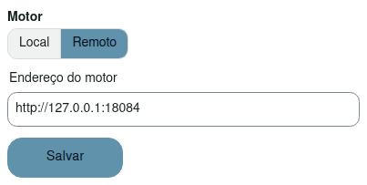 [Ver captura completa](imagens/motor-remoto-original.webp)

As contas e o histórico de cada motor ficam onde foram gravados. Para voltar às suas conversas deste dispositivo, inclusive se o motor remoto sair do ar, selecione **Local** e salve. O motor remoto continua funcionando no servidor.

Para um motor local de teste em outro computador, restrinja o acesso com um
[túnel SSH ou uma rede privada](../arquitetura/index.md#motor-hospedado).

### Conectar a um servidor OIDC

Use a rc.28 ou posterior no servidor e no desktop.

1. Abra o site do Oiê hospedado e selecione **Entrar**.
2. Vá a **Configurações → Geral → Chaves de acesso**. Dê um nome que
   identifique o dispositivo, selecione **Criar chave de acesso** e depois
   **Copiar chave**. A chave dá acesso completo e vale por 90 dias.
3. No desktop, abra **Configurações → Geral → Motor → Remoto**. Informe o
   endereço HTTPS, cole a chave em **Chave de acesso (se exigida)** e
   selecione **Salvar**.

O desktop verifica a conexão antes de salvar o endereço e a chave no perfil.
Se mudar o endereço depois de colar uma chave, cole a chave do endereço final.
Se sair da tela antes de salvar, cole a chave novamente ao voltar.
Para trocar uma chave vencida, crie outra no site do Oiê hospedado e cole-a na
mesma tela do desktop.

## Diagnóstico e registro de erros

Abra **Configurações → Diagnóstico**, escolha um período e use **Atualizar**
para ver os eventos recentes. Abra uma linha para ver os detalhes. Use
**Copiar** para colocar o trecho na área de transferência. Para salvar o
arquivo `oie-diagnostics.jsonl`, abra a seta ao lado de **Copiar** e
escolha **Baixar**.

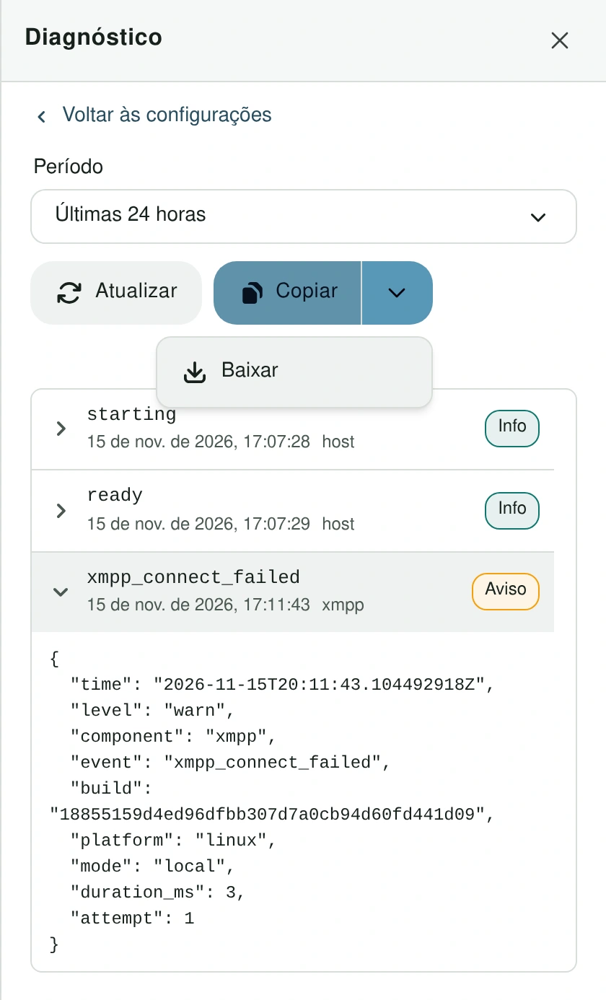 [Ver captura completa](imagens/diagnostico-original.webp)

No aplicativo para computador, **Este dispositivo** continua disponível
se o motor falhar na inicialização ou perder a conexão. Quando o motor
remoto oferecer diagnóstico, selecione **Servidor** e informe a chave de
acesso fornecida por quem administra a instalação.

O registro inclui horários e detalhes de falhas. Mensagens, rascunhos,
nomes de contas, endereços, credenciais e caminhos de arquivos ficam
fora do registro. O arquivo só é compartilhado quando você decide enviá-lo.

## Apagar todos os dados

Abra **Configurações → Geral → Ações destrutivas → Apagar todos os dados**.

Leia o aviso e digite `delete` para confirmar. A exclusão apaga as contas, o histórico e os arquivos guardados pelo motor selecionado. Em um motor compartilhado, isso afeta todos os dispositivos conectados.

## Contas XMPP

No rodapé da lista de conversas, abra **Trocar de conta** e selecione **Adicionar conta**. Informe o endereço completo da sua conta XMPP, como `ana@exemplo.org`, dê um nome à conta e selecione **Salvar conta**. No painel da conta, use **Conectar** com a senha do servidor XMPP. Para voltar a esse painel depois, use **Trocar de conta → Gerenciar contas**.

Use **Trocar de conta** para ver todas as conversas ou filtrar por uma conta. Ao iniciar uma conversa, escolha a conta que você quer usar. As conversas de cada conta são independentes.

Em **Gerenciar contas**, abra o **Perfil** da conta e use **Editar nome** e **Salvar nome** para alterar o nome mostrado no Oiê. Com a conta conectada, use **Editar foto**, escolha uma imagem PNG, JPEG ou GIF de até 512 KB e confira a prévia antes de selecionar **Salvar foto**.

A borda dos avatares das conversas usa a cor da conta de origem, assim como o
avatar em **Trocar de conta**. O nome e o endereço identificam a conta por
escrito.

[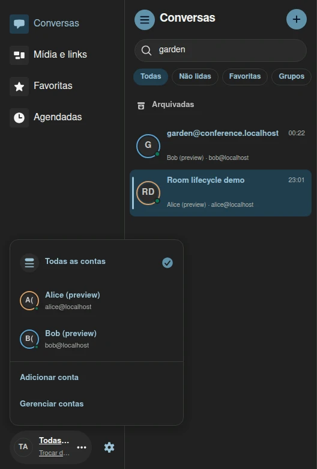](imagens/seletor-de-contas-original.webp)

### Contatos

Em **Trocar de conta → Gerenciar contas**, abra o **Perfil** da conta e escolha
**Contatos**. Com a conta conectada, informe o endereço XMPP da pessoa e
selecione **Adicionar contato**. Em **Solicitações de contato**, use **Aceitar**
ou **Recusar**.

A presença aparece na lista quando o contato compartilha a disponibilidade
com sua conta. Para tirar um endereço da lista, selecione **Remover** ao lado
dele. O Oiê mantém a conversa e as mensagens guardadas.

[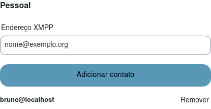](imagens/contatos-original.webp)

### Disponibilidade e digitação

No **Perfil** da conta, abra **Disponibilidade**, escolha **Disponível**,
**Ausente** ou **Não perturbe** e selecione **Salvar**. Em **Não perturbe**,
as mensagens continuam chegando sem avisos ou sons para aquela conta.

Desative **Mostrar quando estou digitando** e selecione **Salvar** para
deixar de enviar o indicador nas conversas diretas compatíveis.

[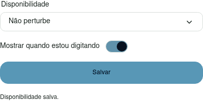](imagens/disponibilidade-conta-original.webp)

### Remover uma conta

Em **Trocar de conta → Gerenciar contas**, abra a conta e selecione **Remover conta** no rodapé dos detalhes. Confira o endereço e confirme em **Remover conta**. Escolha **Desconectar** se quiser apenas sair do servidor e manter as conversas no Oiê.

A remoção apaga a senha salva, as conversas e as mensagens pendentes dessa conta no Oiê. As outras contas e as mensagens no servidor XMPP são mantidas. Se você usa um motor remoto, a conta também some dos outros dispositivos conectados a ele.

[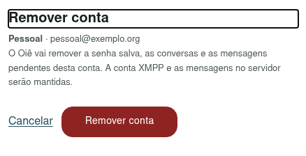](imagens/remover-conta-original.webp)

## Solicitações de mensagem e convites recebidos

A primeira mensagem de uma conversa direta sem histórico anterior pode aparecer como **Solicitação de mensagem**. Confira o endereço no cabeçalho. Use **Aceitar** para ler e responder, ou **Arquivar** para tirar a solicitação da lista principal. O conteúdo fica oculto até você aceitar.

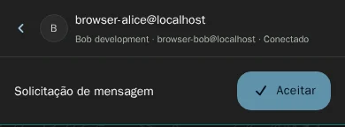

Uma solicitação arquivada continua em **Arquivadas**, abaixo dos filtros da lista de conversas, mesmo se chegarem mais mensagens. Selecione **Arquivadas** novamente para voltar à lista principal. Se você aceitar uma solicitação de mensagem por lá, a conversa volta à lista principal. Em **Convite para sala**, use **Entrar na sala** para pedir a entrada. O conteúdo aparece quando o servidor XMPP confirma. Você também pode arquivar o convite e decidir depois.

## Remover uma conversa direta

Em **Mais opções → Remover das conversas**, confirme a remoção para tirar
a conversa de **Conversas** e **Arquivadas**. O histórico fica salvo.
Abra o endereço novamente com a mesma conta, ou receba uma nova mensagem
do contato, para a conversa voltar à lista.

Nas salas e nas conversas diretas removidas, os links da busca, de **Favoritas**
e de **Mídia e links** abrem o histórico salvo em modo de leitura. A conversa
continua fora da lista.

Para ver **Detalhes da conversa**, clique na foto ou nas iniciais do cabeçalho.

## Salas, convites e entrada automática

Ao conectar a conta, o Oiê respeita os favoritos XMPP marcados para entrada automática. Usa a parte antes do `@` no endereço da conta como apelido inicial. Se você escolheu outro apelido ou saiu explicitamente de uma sala no Oiê, essa decisão tem prioridade. Para entrar em uma sala salva, abra a conversa e use **Entrar na sala**.

Abra o menu **Nova conversa** e escolha **Conversa direta**, **Entrar na sala** ou **Criar sala**. Para entrar ou criar uma sala, siga o formulário da opção escolhida. Selecione a conta e informe um endereço, como `trilha@salas.exemplo.org`. Para entrar, você também pode colar um convite no formato `xmpp:trilha@salas.exemplo.org?join`. Em um cartão de convite, **Ver sala** abre o formulário com o endereço preenchido.

A prévia pode mostrar nome, descrição, assunto, foto e número de participantes, conforme o que o serviço disponibiliza à conta selecionada. A entrada só acontece depois que você confirma. A criação de salas depende do suporte do serviço XMPP. Se a sala exigir senha, informe-a no formulário de entrada.

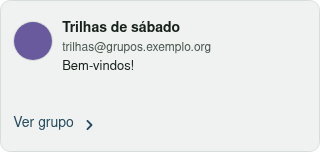

### Descobrir e gerenciar salas

- Em **Nova conversa → Entrar na sala**, abra **Explorar salas públicas** e selecione uma sala para preencher o endereço e ver a prévia. Confirme quando quiser entrar.
- Dentro de uma sala, abra **Mais opções → Gerenciar sala**. Em **Detalhes**, edite o nome, o tópico ou a foto conforme as permissões da sua conta. Use **Mais opções → Convidar pessoas** para enviar um convite quando a sala permitir.
- Em **Participantes**, busque pelo apelido e abra o nome da pessoa para ver as ações disponíveis. Dependendo das permissões, você pode alterar a função, remover a pessoa ou ajustar o acesso à sala. Em **Banimentos**, administradores e proprietários podem buscar um banimento, banir por endereço ou retirar um banimento.
- Se o servidor oferecer moderação e sua conta tiver permissão, use **Remover mensagem** no menu da mensagem. A remoção aparece quando a sala a confirma.

### Conferir o endereço e remover salas

Ao criar uma sala, use o domínio do serviço de salas XMPP. Por exemplo, se a
conta for `ana@exemplo.org`, o endereço da sala pode ser
`trilha@salas.exemplo.org`. Confira com quem administra o servidor qual
domínio usar. Se o endereço não puder ser confirmado, o Oiê mantém o
formulário aberto para você corrigir ou tentar de novo.

- **Mais opções → Remover das conversas** tira a sala de **Conversas** e
  **Arquivadas** e interrompe a entrada automática pelo Oiê. Isso funciona
  também para uma sala que não conectou. A sala e o histórico salvo continuam
  disponíveis. Para trazê-la de volta, use **Entrar na sala** e informe o endereço.
- Se você for proprietário, entre na sala e vá a **Mais opções → Gerenciar
  sala → Detalhes → Excluir sala para todos**. Confirme para excluir a sala
  do servidor e remover todos os participantes. Quando o servidor confirmar,
  a sala sai de **Conversas** e **Arquivadas** da conta que pediu a exclusão.
  O histórico salvo será mantido. Quem recebe o aviso de exclusão vê **Sala
  excluída** e pode remover a sala da própria lista.

[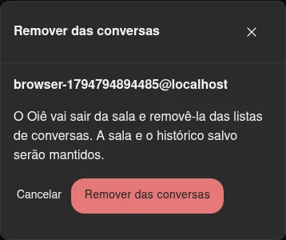](imagens/remover-sala-original.webp)

[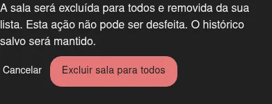](imagens/excluir-sala-original.webp)

### Ver o estado de uma sala

O ponto no avatar mostra o estado da sala. O cabeçalho exibe o estado por
escrito, e a lista destaca quando você está fora da sala ou quando há um
problema.

- **Na sala** indica que você já entrou.
- **Conta desconectada** aparece quando sua conta está sem conexão.
- **Sala excluída** aparece quando o servidor confirma a exclusão. O histórico
  que você já tem continua acessível.
- **Acesso restrito** indica que sua entrada foi recusada. **Sala
  indisponível** indica que o Oiê não conseguiu acessar a sala.

[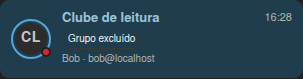](imagens/estado-sala-excluida-original.webp)

## Histórico e busca em salas

Para abrir **Detalhes da conversa**, clique na foto ou nas iniciais no cabeçalho da conversa, ou abra **Mais opções → Detalhes da conversa**. Use **Baixar histórico antigo automaticamente** para escolher como o Oiê recupera o histórico daquela sala. Com a opção ligada, ele baixa mensagens antigas aos poucos. Com a opção desligada, pode buscá-las quando você usa **Mensagens anteriores** no topo da conversa ou faz uma busca, conforme o servidor permitir.

Dentro de uma sala, abra **Mais opções** e selecione **Pesquisar mensagens**. Essa busca também pode consultar o arquivo do servidor, quando ele oferece busca por texto. Ative **Incluir histórico de edições** para encontrar versões anteriores de mensagens editadas. Use os [atalhos de busca](../atalhos/index.md#busca-na-conversa) para percorrer os resultados.

Buscar por `arqiuvo` nas mensagens guardadas pode realçar **arquivo** no balão. Se o resultado vier de uma versão anterior ou dos detalhes de um link, o realce aparece no trecho do resultado. Ao recarregar a página com a busca aberta, o Oiê volta à versão anterior selecionada.

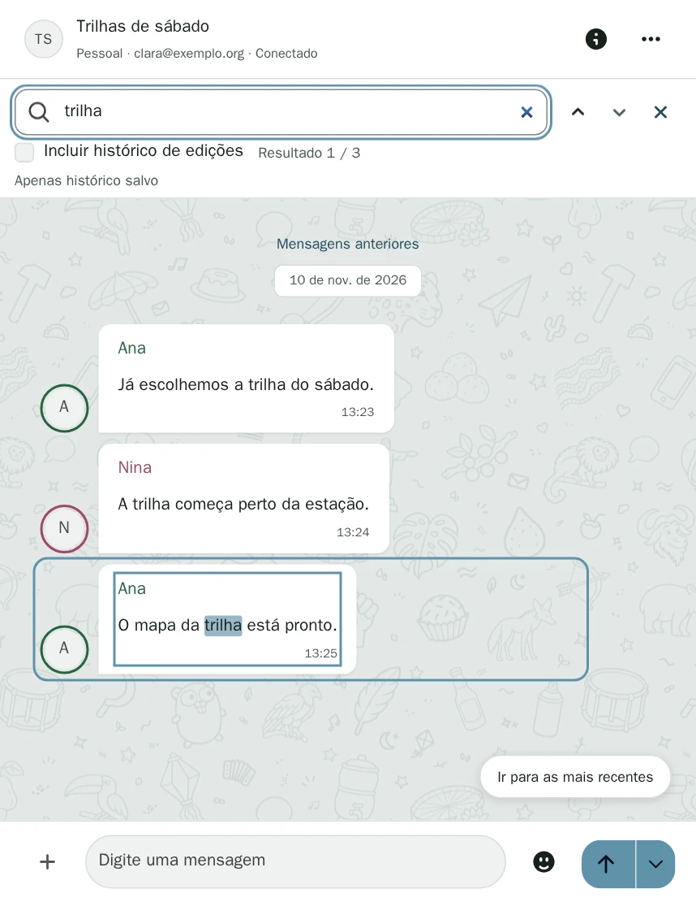

## Retenção de mensagens

Em **Configurações → Este dispositivo → Retenção de mensagens**, escolha os prazos padrão para **Salas** e **Conversas diretas**. Esses prazos valem para o motor do Oiê em uso, inclusive quando ele é compartilhado entre dispositivos. Para mudar o prazo de uma conversa, abra **Mais opções → Detalhes da conversa → Retenção de mensagens**. Use **Usar o padrão** para voltar ao prazo global.

Por padrão, as salas têm prazo de **180 dias** e as conversas diretas usam **Sem limite**. O Oiê preserva as **100 mensagens mais recentes já guardadas de cada sala** e todas as mensagens favoritadas. Reduzir o prazo pode apagar outras mensagens antigas do histórico guardado pelo motor. Em um envio agendado, o prazo conta a partir do envio. Se a mensagem original de uma resposta expirar, o texto da resposta continua visível e a citação fica indisponível.

O prazo também limita a recuperação do histórico no XMPP. Uma instalação nova pode recuperar menos de 100 mensagens de uma sala, dependendo do prazo e dos dados ainda disponíveis no servidor. Com **Sem limite**, as mensagens deixam de expirar por idade, o histórico pode ocupar mais espaço e a recuperação pode alcançar as mensagens mais antigas que o servidor ainda oferece à sua conta.

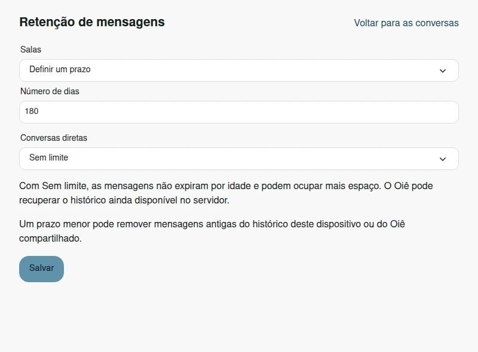

## Mensagens não lidas

Depois de percorrer o histórico, role até o fim ou use **Ir para as mais recentes** acima do campo de mensagem, quando esse botão aparecer. Se chegarem mensagens enquanto você estiver no histórico, o botão mostra **Novas mensagens · ir para as últimas**. Ao permanecer no fim com a janela ou aba em foco e sem buscas ou diálogos abertos, o Oiê marca como lidas também as mensagens anteriores que ficaram fora da tela. O contador de não lidas e o indicador de menções são atualizados na lista de conversas.

### Marcar uma conversa como lida ou não lida

No cabeçalho da conversa, abra **Mais opções → Marcar como lida** para zerar
o contador e limpar qualquer lembrete, inclusive se você estiver no meio do
histórico.

Use **Mais opções → Marcar como não lida** para incluir a conversa no filtro
**Não lidas**. Se todas as mensagens já foram lidas, a lista mostra um ponto
no lugar do contador. Para tirar o lembrete, escolha **Marcar como lida**.

[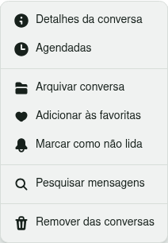](imagens/marcar-conversa-como-nao-lida-original.webp)

## Notificações de mensagens

Em **Configurações → Este dispositivo → Notificações**, ative **Notificações de mensagens** para receber banners e conceda a permissão quando o navegador ou o sistema pedir.

O som vem ativado para mensagens diretas e, nas salas, para menções e respostas a mensagens suas. Em **Som nas salas**, você pode escolher **Todas as mensagens**, manter **Menções e respostas a você** ou selecionar **Desativado**. Há controles para mensagens diretas, salas arquivadas e a conversa em foco. **Som de notificação** desliga todos os toques.

Use **Escolher arquivo** em **Toque** para usar um áudio seu de até 5 MB. O Oiê usa os primeiros dois segundos e guarda o toque neste dispositivo. Use o botão de reprodução para ouvi-lo ou o **X** ao lado do nome do arquivo para voltar ao toque do Oiê.

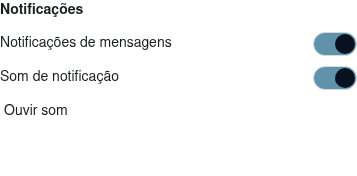 [Ver captura completa](imagens/notificacoes-original.webp)

Para silenciar uma conversa ou sala neste dispositivo, abra **Detalhes** no menu da conversa e ative **Silenciar notificações neste dispositivo**. Ao receber várias mensagens em sequência, o Oiê toca uma vez a cada dois segundos. O contador de mensagens não lidas continua funcionando.

Os alertas chegam enquanto o Oiê está aberto e conectado. Selecione o banner para abrir a mensagem. No desktop, o clique restaura a janela se ela estiver escondida. No navegador ou no app web instalado, um banner que ainda estiver na central de notificações pode reabrir o Oiê após fechar a janela. Se o navegador bloquear áudio ao abrir o Oiê, interaja com a janela para habilitar a reprodução.

## Busca geral e filtros por conta

Digite no campo **Pesquisar**, na lista de conversas. **Tudo** reúne conversas, contatos salvos e mensagens guardadas. Use **Conversas** ou **Mensagens** para restringir os resultados. Em **Contas**, marque uma ou mais contas ou limpe a seleção para pesquisar em todas.

Os resultados destacam os termos encontrados e mostram a conta e a conversa de origem. Abra um resultado para ir à mensagem. Se ativar **Incluir histórico de edições**, um resultado marcado como **Versão anterior** mostra o trecho guardado e abre a mensagem atual na conversa.

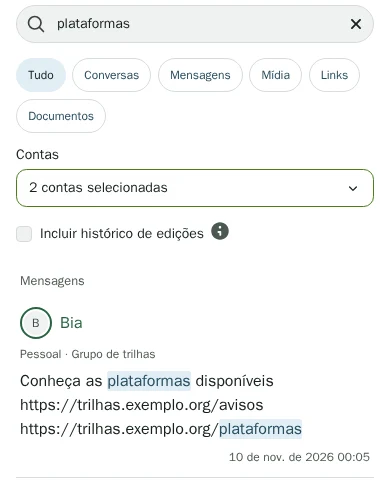

Os atalhos **Mídia**, **Links** e **Documentos** abrem o catálogo com o mesmo texto de busca e as contas selecionadas. Para uma consulta rápida em todas as contas, use [Ctrl + K ou ⌘ + K](../atalhos/index.md#busca-geral). A consulta dessa janela é independente da busca da lista.

## Mídia e links

Abra **Mídia e links** na barra lateral para encontrar o que foi compartilhado. As abas **Mídia**, **Links** e **Documentos** agrupam os itens por mês. Use **Contas** para buscar por nome ou endereço e marcar uma ou mais contas. **Limpar seleção** volta a mostrar itens de todas as contas. Sua escolha em **Trocar de conta** continua valendo nas outras telas.

No menu do cartão, use **Ir para a mensagem** para voltar à conversa de origem. Selecione um documento para abri-lo. Se a prévia falhar, use **Tentar novamente** quando essa opção aparecer. O cabeçalho também permite baixar o arquivo ou abrir o endereço original.

## Mensagens favoritadas

No menu de uma mensagem, escolha **Favoritar**. Abra **Favoritas** na navegação lateral e use **Pesquisar mensagens favoritas** para buscar pelo texto, pelo remetente ou pela conversa de origem. Os cartões incluem mensagens de conversas arquivadas. Use **Trocar de conta** para restringir a lista a uma conta ou **Todas as contas** para reunir as mensagens de todas elas.

No menu do cartão, use **Ir para a mensagem** para abrir a conversa no ponto em que ela foi enviada. Você também pode **Copiar mensagem original** ou **Encaminhar**. Para tirar uma mensagem da lista, selecione a estrela. Para localizar conversas favoritas, use o filtro **Favoritas** na lista de conversas.

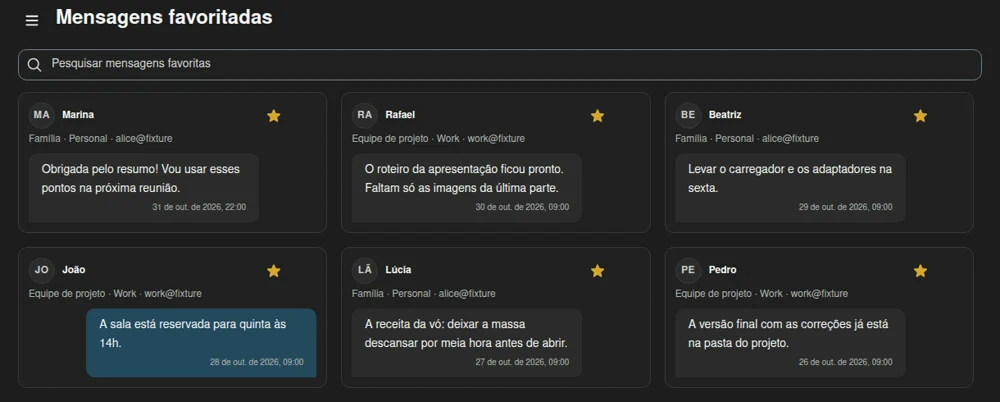

### Favoritar em Mídia e links

Em **Mídia e links**, clique na estrela no canto superior esquerdo do
cartão para favoritar a mensagem de origem. A estrela cinza aparece ao
passar o mouse ou focar o cartão pelo teclado. Nos favoritos, ela fica
amarela e visível. Em telas de toque, o botão fica sempre disponível.
Itens da mesma mensagem compartilham a estrela.

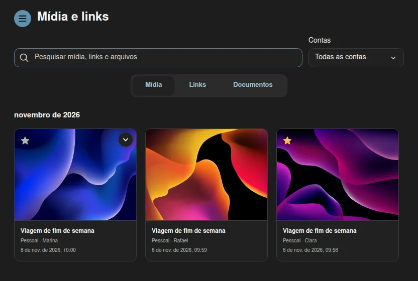

## Encaminhar mensagens

Abra **Encaminhar** no menu de uma mensagem em **Conversas**, **Favoritas** ou **Mídia e links**. Confira a prévia, escolha uma ou mais salas e confirme em **Encaminhar**. Cada sala mostra a conta que enviará a cópia.

O Oiê prepara o texto e os anexos para cada destino. Se algum envio falhar ou ficar sem confirmação, veja o aviso junto à sala e use **Tentar novamente**. Ao tentar novamente, o Oiê pula as salas cuja cópia já entrou na fila.

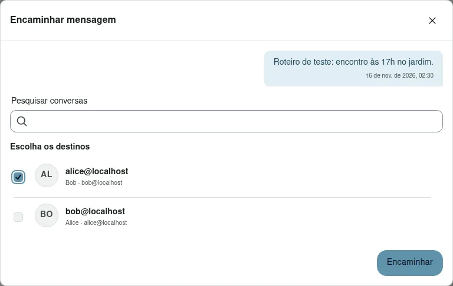

## Anexos no rascunho

Ao lado do campo de mensagem, abra **+** e escolha **Imagem** ou **Arquivo**. No navegador, você também pode colar um arquivo no campo ou arrastá-lo para a conversa. Escreva a legenda no próprio campo de mensagem.

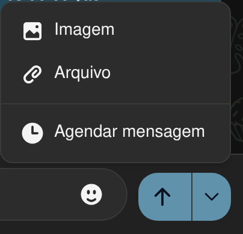

Você pode clicar no nome de um anexo pronto para baixar o original. No aplicativo de desktop, isso abre a janela do sistema para salvar o arquivo. Use **Remover anexo** para tirar um item do rascunho. Se o preparo falhar, use **Tentar novamente** ou remova o arquivo. Se usou o seletor do Flatpak, escolha o arquivo novamente. Quando todos estiverem prontos, envie a mensagem ou [agende o envio](#envio-agendado).

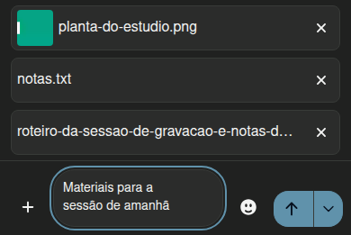

O Oiê aceita até 16 arquivos por mensagem, de até 20 MiB cada. O serviço XMPP pode impor um limite menor ou não permitir anexos naquela conversa. Quem recebe a mensagem pode baixar os arquivos pelos links enviados junto com a legenda. Os anexos prontos ficam no rascunho ao recarregar a página. Aguarde o preparo antes de trocar de conversa.

## Prévia e reprodução de vídeos

Para anexar um vídeo, escolha **+ → Arquivo** e selecione o arquivo.
Use **Reproduzir vídeo** na miniatura para assistir antes de enviar. O nome
do arquivo e a opção **Remover anexo** continuam disponíveis se a miniatura
não puder ser criada.

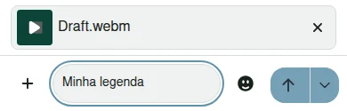

Em uma conversa direta ou sala, escolha **Reproduzir vídeo** no cartão para
assistir. Se a miniatura não aparecer, você ainda pode usar o botão de
reprodução. Em **Configurações → Este dispositivo**, ajuste **Gerar prévias de
vídeo automaticamente**. Com essa opção desativada, você pode pedir uma prévia
pelo cartão ou pelo menu de ações em **Mídia**.

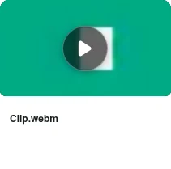

## Envio agendado

Abra o menu junto ao botão de envio, escolha **Agendar mensagem** e confira a data, o horário e a mensagem. Em **Agendadas**, você pode editar, reagendar, cancelar ou pedir o envio imediato enquanto a mensagem ainda estiver aguardando o primeiro envio.

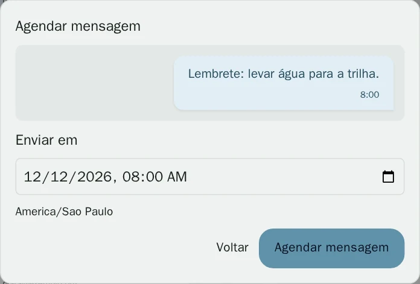

Na agenda da navegação lateral, use **Conversas** para escolher quais destinos quer ver. Os envios do mesmo dia aparecem em colunas quando há espaço.

Para editar uma mensagem sem sair da conversa, abra **Mais opções → Agendadas → Editar mensagem**. O campo de mensagem passa a mostrar o conteúdo agendado. Ao salvar ou cancelar a edição, o Oiê restaura o rascunho que você já tinha naquela conversa.

Se o aplicativo ou a conexão estiver indisponível no horário marcado, o Oiê tenta enviar quando voltar a funcionar e a conversa estiver disponível. Em salas, isso exige que a conta esteja na sala. Fechar a janela do aplicativo de desktop o mantém em execução. Para encerrá-lo, use [o atalho de saída](../atalhos/index.md#aplicativo-de-desktop).

## Citações e texto original

O Oiê exibe Markdown nas mensagens por padrão. Para citar várias linhas, comece cada uma com `>`. Uma linha sem o marcador fica fora da citação, mesmo quando vem logo abaixo. Em **Configurações → Este dispositivo**, use **Formatar mensagens com Markdown** para ajustar a exibição. No menu da mensagem, use **Copiar mensagem original** para copiar o texto com os marcadores Markdown.

O lápis ao lado do horário indica uma mensagem editada. Selecione-o ou use **Ver histórico de edições** no menu da mensagem para consultar as versões que o Oiê guardou.

## Idioma e fuso horário

Em **Configurações → Geral**, use a busca em **Idioma** ou **Fuso horário de exibição**. A lista de fusos mostra o deslocamento atual em relação ao UTC, incluindo o horário de verão quando aplicável. Você pode buscar pela cidade ou pelo deslocamento, como `UTC+09:00`.

Escolha **Fuso horário do sistema** para acompanhar o fuso do dispositivo. O idioma e o fuso escolhidos ficam salvos neste aplicativo ou navegador. O agendamento também usa esse fuso para interpretar a data e o horário que você informa.

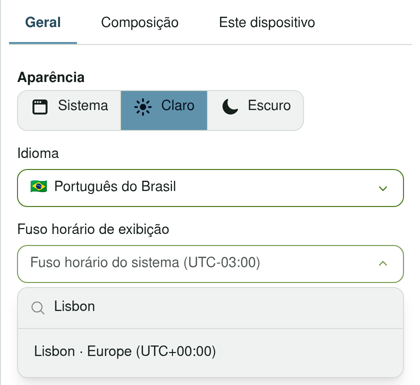
