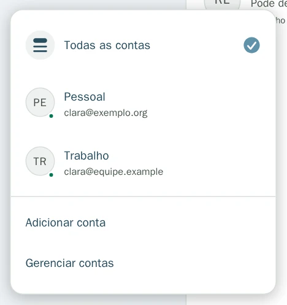
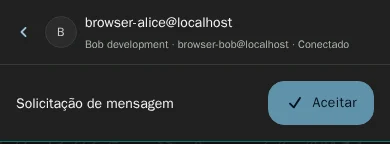
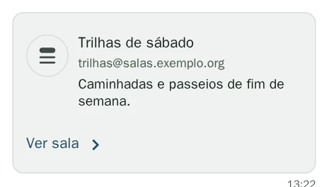
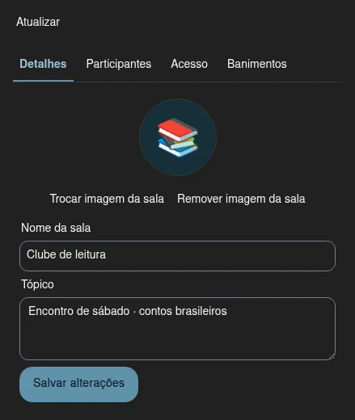
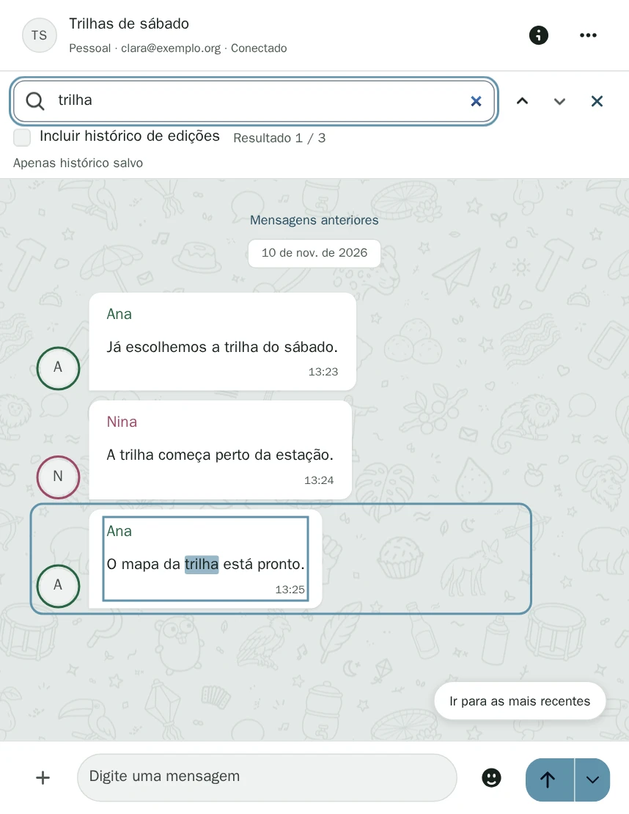
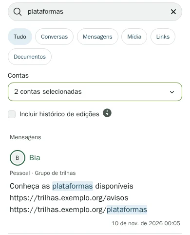
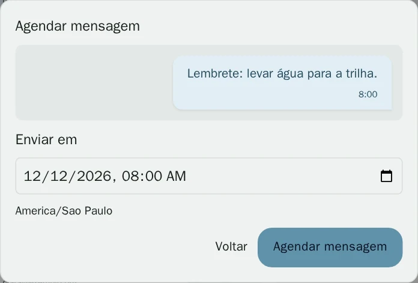

# Manual do Oiê

Este manual acompanha o [Oiê v0.0.1-rc.8](../../baixar/index.md).

## Contas XMPP

No rodapé da lista de conversas, abra **Trocar de conta** e selecione **Adicionar conta**. Informe o endereço completo da sua conta XMPP, como `ana@exemplo.org`, dê um nome à conta e selecione **Salvar conta**. No painel da conta, use **Conectar** com a senha do servidor XMPP. Para voltar a esse painel depois, use **Trocar de conta → Gerenciar contas**.

Use **Trocar de conta** para ver todas as conversas ou filtrar por uma conta. Ao iniciar uma conversa, escolha a conta que você quer usar. As conversas de cada conta são independentes.

## Solicitações de mensagem e convites recebidos

A primeira mensagem de uma conversa direta sem histórico anterior pode aparecer como **Solicitação de mensagem**. Confira o endereço no cabeçalho. Use **Aceitar** para ler e responder, ou **Arquivar** para tirar a solicitação da lista principal. O conteúdo fica oculto até você aceitar.

[Ver a captura da solicitação no tamanho original](imagens/solicitacao-de-mensagem-original.webp)

Uma solicitação arquivada continua em **Arquivadas** mesmo se chegarem mais mensagens. Se você aceitar uma solicitação de mensagem por lá, a conversa volta à lista principal. Em **Convite para sala**, use **Entrar na sala** para pedir a entrada. O conteúdo aparece quando o servidor XMPP confirma. Você também pode arquivar o convite e decidir depois.

## Salas, convites e entrada automática

Ao conectar a conta, o Oiê respeita os favoritos XMPP marcados para entrada automática. Usa a parte antes do `@` no endereço da conta como apelido inicial. Se você escolheu outro apelido ou saiu explicitamente de uma sala no Oiê, essa decisão tem prioridade. Para entrar em uma sala salva, abra a conversa e use **Entrar na sala**.

Abra **Nova conversa** e escolha **Entrar na sala** ou **Criar sala**. Selecione a conta e informe um endereço, como `trilha@salas.exemplo.org`. Para entrar, você também pode colar um convite no formato `xmpp:trilha@salas.exemplo.org?join`. Em um cartão de convite, **Ver sala** abre o formulário com o endereço preenchido.

A prévia pode mostrar nome, descrição, assunto, foto e número de participantes, conforme o que o serviço disponibiliza à conta selecionada. A entrada só acontece depois que você confirma. A criação de salas depende do suporte do serviço XMPP. A entrada por endereço aceita salas sem senha.

### Descobrir e gerenciar salas

Estas opções estão em desenvolvimento para uma versão posterior à v0.0.1-rc.8 disponível em **Baixar**.

- Em **Nova conversa → Entrar na sala**, abra **Explorar salas públicas** e selecione uma sala para preencher o endereço e ver a prévia. Se a sala exigir senha, informe-a antes de entrar.
- Dentro da sala, abra **Mais opções → Gerenciar sala**. Em **Detalhes**, edite o nome e o tópico conforme suas permissões. Se você for proprietário e o servidor oferecer suporte, use **Trocar imagem da sala** ou **Remover imagem da sala**.
- Na aba **Participantes**, abra o menu de três pontos ao lado da pessoa para ver as ações disponíveis, como permitir falar, remover da sala ou banir. Use **Mais opções → Convidar pessoas** para enviar um convite.
- Administradores e proprietários podem consultar e alterar o acesso na aba **Acesso**. Na aba **Banimentos**, é possível banir um endereço ou retirar um banimento da lista.
- Quando a sala oferece moderação de mensagens, moderadores podem usar **Remover mensagem** no menu da mensagem. A remoção aparece na conversa após a confirmação da sala.

[Ver a captura completa](imagens/gerenciar-sala-original.webp)

## Histórico e busca em salas

Em **Detalhes da conversa**, use **Baixar histórico antigo automaticamente** para escolher como o Oiê recupera o histórico daquela sala. Com a opção ligada, ele baixa mensagens antigas aos poucos. Com a opção desligada, pode buscá-las quando você usa **Mensagens anteriores** no topo da conversa ou faz uma busca, conforme o servidor permitir.

Dentro de uma sala, abra **Mais opções** e selecione **Pesquisar mensagens**. Essa busca também pode consultar o arquivo do servidor, quando ele oferece busca por texto. Ative **Incluir histórico de edições** para encontrar versões anteriores de mensagens editadas. Use os [atalhos de busca](../atalhos/index.md#busca-na-conversa) para percorrer os resultados.

## Busca geral e filtros por conta

Digite no campo **Pesquisar**, na lista de conversas. **Tudo** reúne conversas, contatos salvos e mensagens guardadas. Use **Conversas** ou **Mensagens** para restringir os resultados. Em **Contas**, marque uma ou mais contas ou limpe a seleção para pesquisar em todas.

Os resultados destacam os termos encontrados e mostram a conta e a conversa de origem. Abra um resultado para ir à mensagem. Se ativar **Incluir histórico de edições**, um resultado marcado como **Versão anterior** mostra o trecho guardado e abre a mensagem atual na conversa.

[Ver a captura da busca geral no tamanho original](imagens/busca-geral-original.webp)

Os atalhos **Mídia**, **Links** e **Documentos** abrem o catálogo com o mesmo texto de busca e as contas selecionadas. Para uma consulta rápida em todas as contas, use [Ctrl + K ou ⌘ + K](../atalhos/index.md#busca-geral). A consulta dessa janela é independente da busca da lista.

## Envio agendado

Abra o menu junto ao botão de envio, escolha **Agendar mensagem** e confira a data, o horário e a mensagem. Em **Agendadas**, você pode editar, reagendar, cancelar ou pedir o envio imediato enquanto a mensagem ainda estiver aguardando o primeiro envio.

Para editar uma mensagem sem sair da conversa, abra **Mais opções → Agendadas → Editar mensagem**. O campo de mensagem passa a mostrar o conteúdo agendado. Ao salvar ou cancelar a edição, o Oiê restaura o rascunho que você já tinha naquela conversa.

Se o aplicativo ou a conexão estiver indisponível no horário marcado, o Oiê tenta enviar quando voltar a funcionar e a conversa estiver disponível. Em salas, isso exige que a conta esteja na sala. Fechar a janela do aplicativo de desktop o mantém em execução. Para encerrá-lo, use [o atalho de saída](../atalhos/index.md#aplicativo-de-desktop).

## Citações e texto original

O Oiê exibe Markdown nas mensagens por padrão. Para citar várias linhas, comece cada uma com `>`. Uma linha sem o marcador fica fora da citação, mesmo quando vem logo abaixo. Em **Configurações → Este dispositivo**, use **Formatar mensagens com Markdown** para ajustar a exibição. No menu da mensagem, use **Copiar mensagem original** para copiar o texto com os marcadores Markdown.

O lápis ao lado do horário indica uma mensagem editada. Selecione-o ou use **Ver histórico de edições** no menu da mensagem para consultar as versões que o Oiê guardou.

