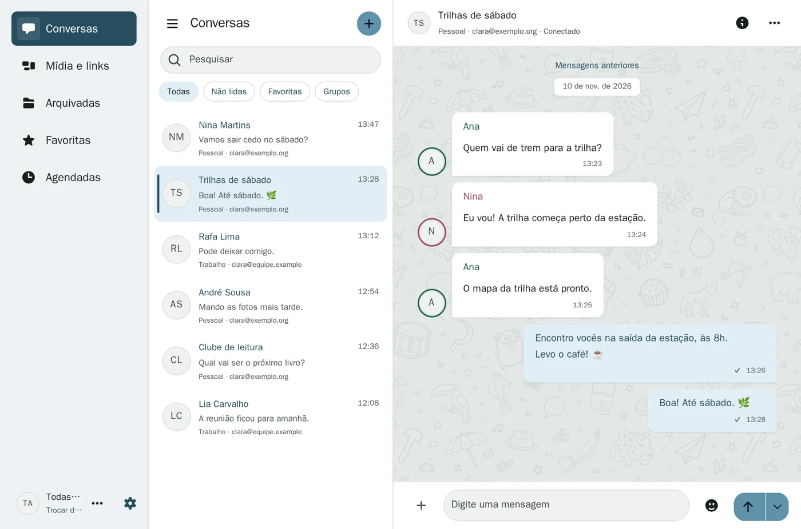

# Um Oiê para suas conversas.

Reúna suas conversas e salas do XMPP em um só lugar.

Conecte as contas que você já usa, retome conversas pelo histórico e guarde as mensagens que quer encontrar depois.

- [Baixar o Oiê](baixar/index.md)

## Uma olhada no Oiê

*Interface do Oiê com uma conversa de exemplo.*

## Converse com quem já está no XMPP

Troque mensagens diretas, entre nas suas salas salvas e responda a mensagens do grupo. Se você usa mais de uma conta, escolha com qual delas quer conversar.

## Retome de onde parou

Leia as mensagens recentes enquanto o Oiê busca o histórico disponível no seu servidor. Use estrelas para guardar mensagens que você quer consultar depois.
